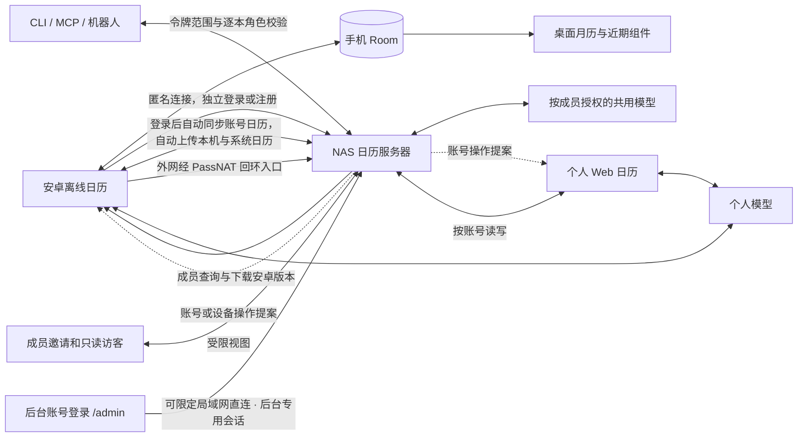
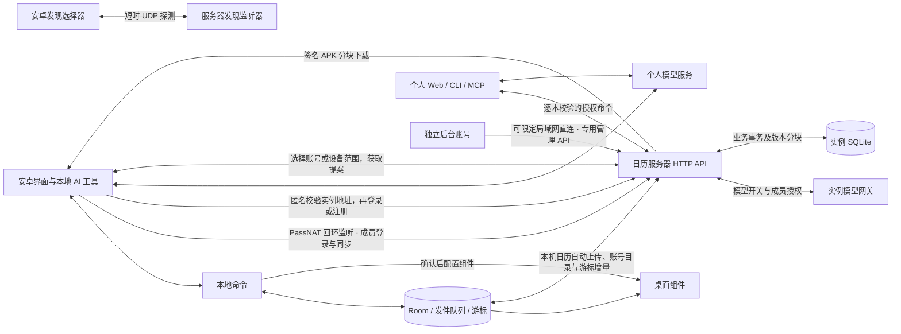

# TimePin 架构与开发计划

TimePin 是面向家庭和小团队的开源自部署日历。安卓可独立离线运行，NAS 上的实例负责多人协作。安卓登录后自动接收账号名下和获授权的服务器日历。登录后自动将全部未连接的本机日历上传到当前账号，包括授权读取的安卓系统来源。**开发顺序先完成核心、Web、自部署与自动化，最后实现安卓和桌面小组件。** 安卓的离线行为和小组件所需数据从第一阶段开始纳入契约。

[查看应用关系图](./TimePin-应用关系图.svg) · [查看技术架构图](./TimePin-技术架构图.svg) · [开发代理规约](./AGENTS.md)

## 当前架构决策 · 日历服务器、个人客户端与独立后台

助手提供日历、账号和安卓设备三种显式范围。日历对话保持至少勾选一本；账号对话可在零日历时建表、建团组或接受邀请。设备对话将所选本机日历及组件元数据交给用户选择的模型形成提案，确认后由手机调用组件与同步命令。实例只为获授权成员生成提案，账号确认复用实例管理事务，设备确认复核选区、当前账号和冲突队列版本。此扩展不迁移数据库，既有日历对话和组件编号继续有效。验收覆盖两种模型、空选区、确认重试和过期提案。

自动化令牌支持单本日历或本人全部日历，覆盖以后新建和新加入的日历。两种范围都按每本日历的实时成员角色与令牌上限取较低者。实例管理、账号操作和服务器模型仍要求对应会话。SQLite v8 保留已有令牌的目标、摘要和期限。v9 支持整本日历删除。个人所有者或归属团组的管理员确认删除后，服务器在同一事务清理日程、邀请、共享和专属令牌，并保留已退役编号。离线副本沿现有撤权协议收回。迁移和撤权验收须覆盖个人、团组、多个角色和其他账号的私有日历。

NAS 运行一个 Go 日历服务器。个人 Web 日历、安卓和管理后台各自调用 HTTP API；服务器可以随程序分发两个网页入口。个人日历通过登录后的会话取数，部署者从服务器本机配置独立后台账号。在 /admin 登录取得专用会话，管理命令只走 /api/v1/admin/manage。个人账号注册后进入 Web 日历，个人会话与后台会话各自退出。可独立托管个人 Web 静态目录，并将同源 /api/v1/ 代理给日历服务器。管理员可以启停账号、配置注册策略、设置共用模型的地址与密钥、开关共用模型和授权成员。后台权限不会授予管理员读取其他人日历的能力。

运维后台按实例总览、账号、日历与团组、共享与访问、实例设置和操作记录组织。管理员可维护归属与成员授权、发放一次性注册码与账号恢复码、撤销特定访问。目录只返回管理用元数据；实例后台没有读取日程正文的接口。账号恢复由成员提交新密码完成，码值仅在签发时交给管理员，服务器保存摘要。管理员可在实例设置创建经过完整性校验的主机数据库快照，读取日历数据仍须经过个人或共享授权。SQLite 版本 7 新增恢复码、备份登记与后台操作记录，迁移保留已有成员、会话、日历及其编号。验收覆盖过期与重放、换新分享后的撤销冲突、团队最后一位管理员、操作记录去重与隐私字段。

安卓以 Room 为主库，未登录即可编辑和使用组件。用户打开连接页可发现同一局域网的服务器，也能手填地址。设备发现提供候选地址，登录选定实例后自动同步当前账号。Web 在线读取当前账号可见日历，在返回前台时刷新，并在可见期间每 30 秒用索引检查变更摘要；安卓沿原有游标同步。两个客户端都能选择服务器模型或个人兼容接口；个人密钥分别留在安卓密钥库保护的配置和浏览器当前标签页内存。

沿用账号、日历编号、组件引用和同步游标。数据库升至版本 6 时撤除旧个人账号的实例管理映射，保留全部日历、成员、模型授权和个人登录状态。部署者用本机命令初始化或重设后台密码。验收须覆盖双向身份隔离、旧会话迁移、个人账号菜单与后台独立退出。发现使用专用 UDP 端口，Linux 宿主网络可接收 LAN 广播，客户端仅在用户寻找服务时短暂探测。验收包含旧库升级、后台访问控制、停用账号、共用模型撤权、客户端个人模型、真实局域网发现、离线日历与桌面组件，以及周数开关两种布局的每行分隔线。

## 用户如何使用日历

- **个人与组。** 两者均可拥有日历，也可获得某本日历的访问权。个人可以直接邀请家人，科室也可以长期持有多本日历。变更组管理员后，组继续拥有原日历。用户在 Web 或安卓选择要叠加显示的日历，各小组件独立保存自己的选择。
- **事件与颜色。** 每个事件属于一本日历，可指定参与人、覆盖日历默认颜色。共享成员看到相同的事件颜色。事件的创建者由实际执行身份确定，参与人用于日程安排和筛选。只有日期的安排、带时区的起止时刻、跨午夜夜班、重复规则和单次例外均须保留原有时间语义。
- **邀请与外部分享。** 成员可以通过邀请在实例建号或登录。管理者可为指定日历开启免登录只读链接，关闭或换新后旧链接失效。访客只能读取获分享日历的日程视图。个人的日历组合、其他日历及成员管理信息属于独立授权范围。
- **内置与外部 AI。** 安卓可向自配的模型 API 发起对话，也可选用实例提供的共用模型。Web 对话可选择本浏览器的个人模型或获授权的实例模型。外部 AI 可以通过 MCP 使用工具。对明确的单条指令直接执行，对话里的批量写入先显示影响。获授权的自动化程序可直接提交结构化批次。

### 日历内角色

| 角色 | 能做的事 |
|---|---|
| 管理 | 编辑日历及全部事件，管理成员授权、邀请和只读链接 |
| 全表编辑 | 查看、新建、修改和删除本日历内全部事件 |
| 投稿 | 查看日历、新建事件、修改和删除本人创建的事件 |
| 只读 | 查看授权日历内的事件 |

按请求身份解析个人及当前组带来的有效权限，再与调用凭据获授的范围取交集。批量更新和撤销须逐项验证可编辑性。组的成员管理与某本日历的管理是两个独立操作。例如，班表中标为“小王值班”的事件由机器人创建，小王具备投稿角色时，可按参与人筛选这班，编辑它需要额外的全表编辑权。

## 模块边界与数据流

| 模块 | 技术与归属 | 读写行为 |
|---|---|---|
| 自部署实例 | 一个 Go 进程提供内嵌 Web、HTTP API、账号与日历授权、同步、导入及模型接入。Docker 默认使用一个实例和一个持久化卷。 | SQLite 保存实例内的日历、事件、授权、变更记录、导入批次和回执。由业务命令层统一查询和提交数据。 |
| 安卓客户端 | Kotlin，Room 管理手机 SQLite。保存本机日历、同步副本、待提交操作和组件配置。 | 界面与内置 AI 执行同一组本地命令。已连接日历的本地变更与待提交操作在同一事务落库。发布一本本机日历时保留原标识和组件引用。 |
| 桌面组件 | 月历显示带颜色的事件标题，支持翻月、进入选中日期和新增。近期日程按时间列出所选日历的安排。 | 读取本地库，点击编辑进入 App 的命令流程。一次提交只合并刷新受影响的组件。登录、前台检查、联网恢复和编辑触发同步，后台由系统安排。组件可显示最近同步时间。 |
| 外部接口 | 版本化 HTTP API 与 OpenAPI 描述，CLI 支持 JSON 输入输出，MCP 暴露可发现的工具。 | Web、CLI、机器人和 MCP 使用实例授权操作。安卓通过系统 Calendar Provider 只读发现日历，按选择复制到本机。设备上的视图偏好由本机命令管理。 |
| 模型接入 | 个人模型凭据留在设备。实例共用凭据由服务端保管，按成员限制使用。 | 模型只接收完成当前指令所需的信息并提出工具调用。安卓对话由手机执行本地命令。使用共用模型时，实例代转模型请求。Web 对话以发起成员身份调用实例命令。普通浏览、编辑和结构化导入的模型调用数为零。 |

### 个人账号资料

安卓先匿名核对实例标识并保存选定的地址，再从独立页面登录或注册。退出账号后保留服务器地址。仅连接时继续使用本机数据，取得个人会话后才调度同步。升级沿用原账号、服务器地址与组件。独立后台可直接创建成员及默认个人日历、按稳定用户编号修改登录名或重设密码。改名保留归属关系，重设密码撤销个人会话、访问令牌与恢复码。验收覆盖匿名连接、邀请码、后台身份隔离和重复提交。

日历账号拥有独立于登录名的显示昵称和可替换的头像。资料归属实例内的账号，个人 Web 和安卓通过个人会话读取及更新。旧账号默认显示登录名和文字头像。SQLite v10 增加账号资料表，沿用现有账号及会话。安卓按服务器与账号缓存最近的资料以支持离线显示，退出时清除。日历同步和账号状态只携带资料版本，图片在需要时单独读取。验收包括旧库升级、头像跨端更新、两账号隔离、离线展示和撤下头像。

### 操作契约与批量导入

每项应用内业务操作定义名称、输入、数据归属、权限、结果和错误。覆盖事件、日历管理、成员、分享、导入与撤销，以及各端适用的显示设置。网络 API、CLI 和模型工具可共用实例契约，手机用同一套行为样例校验本地实现。

- **查询。** 输入日历选择、时间窗口和必要筛选。窗口采用左闭右开，纳入与窗口相交的事件，也包括从上月跨入本月的夜班。循环事件按窗口展开，再应用例外。日期型事件始终以当地日历日期表达。
- **写入。** 调用指明目标和操作编号。修改、删除携带基准版本，服务端按当前权限核验。回执给出实际事件编号、版本及处理结果。遇到过期版本时返回可比较的差异。
- **导入。** 网页、CLI 和 API 共用 JSON 格式；安卓的系统日历导入复用本机事件命令。批次包含目标日历、来源和事件列表。支持一次性创建，以及用“日历 + 来源 + 稳定外部编号”持续修订。请求编号用于识别重试。外部工具负责把班表图片转成事件，日历只接收结构化数据。删除必须逐项明确指定，漏传的旧事件继续保留。
- **预览和提交。** 预览按行列出新增、更新、跳过与待处理冲突。提交时重新检查权限和基准版本，将实际变更与批次回执一并持久化。同一操作重试返回既有结果。若外部来源上次提交后有人手动改过事件，则报告版本冲突，保留手动修改。
- **撤销。** 用批次编号定位本次创建、修改的事件及其前值。只有仍处于该批次写入版本且当前有权处理的条目才自动还原。回执逐项列出已还原、后续有修改和权限不足。

例如，外部工具第一次提交 30 个有稳定编号的班次，第二次只改其中一个开始时间，预期更新 1 条、跳过 29 条。同一提交超时重试获得原回执。如果排班员已手动改过该班次，预览和提交都会报告冲突。撤销时保留其他成员后来改过的内容。

### 离线与重连

手机先读取本地库。对当前账号可访问的服务器日历建立初始副本后，按日历、按游标拉取增量，包含删除标记与访问权变化。同步模块把收到的一页变更与新游标一起提交。服务端在接收离线操作时再次授权，已撤权则停止该日历后续读取、清理已撤权的共享副本，并把用户离线输入中未能提交的修改标成待处理。两人修改同一事件时，保留已提交版本和本人的待处理改动，给出解决入口。所有其他本机日历照常使用。

## 轻量化与性能基准

默认部署只需应用及数据卷。按日历与时间范围查询，依据查询计划建立索引，限制重复事件的展开窗口。按变更量同步，批量写入在事务提交后统一通知。手机的多个组件共用本地查询和刷新调度。新增常驻服务、轮询或重依赖前，应先用基准定位瓶颈。

| 测量项目 | 固定方法与观察值 |
|---|---|
| 资源与启动 | 使用发布构建，容器限制 **1 核、512 MiB**，固定数据集含约 **20 个账号、10 万条历史事件**。记录构建版本、宿主机、存储介质和数据集标识。记录冷启动到首次可查询的时间，以及启动稳定后的空闲 CPU、常驻内存和批量处理时的峰值。 |
| 月视图 | 在同一批日历及相同月份测量，区分冷、热缓存。记录重复次数、P95 延迟、查询计划和返回条数。数据集含跨月、跨午夜及循环例外。 |
| 导入与同步 | 对同一批事件分别做首次导入、只改一条、原请求重试。记录耗时、实际写入条数与组件刷新次数。已有副本只变更一条时，记录上下行字节和返回事件数。历史库扩大后仍只传本次变化及协议元数据。 |
| 安卓与 AI | 测实际后台任务数、每批合并刷新次数、真机待机耗电和无网操作。手动操作与结构化导入的模型调用计数必须为零。记录设备、系统版本、测试时长及电源状态。 |

上述数字是部署验收环境。首个可部署版本保存实测基线，后续版本用同一数据集、构建方式和资源限制复测。每项结果注明自动化、模拟器、安卓真机或 NAS 实机来源。第一阶段的 Go 基准测量内存命令执行开销，NAS 容器指标在第二阶段起记录。

## 开发顺序与验收

工作项进度以 Git 提交为准。阶段验收通过后，用 `phase-1` 至 `phase-5` 的附注标签标记对应提交。用 `git log --oneline --decorate main` 查看开发记录，用 `git show --no-patch phase-1` 查看第一阶段的验收说明，其他阶段替换编号即可。

| 阶段 | 交付内容 | 阶段完成的证据 |
|---|---|---|
| 1 · 日历核心与跨端契约 | 定义标识、创建者和参与人、事件颜色、时间与重复语义、操作幂等、事件版本、导入格式和离线行为样例。 | 同一组样例覆盖全天事件、跨午夜的夜班、单次循环例外和批次重试。先由服务端运行，安卓阶段复用。 |
| 2 · 自部署服务与 Web | 实现单容器服务、Web 日历、账号、个人与组所有权、角色、邀请、只读链接与结构化导入。采集第一份服务端性能基线。 | Web 中可勾选多本日历并设置事件色。更换组管理员后日历仍归组。投稿者只能修改本人创建的事件。关闭链接后旧链接失效。 |
| 3 · API、CLI、MCP 与 AI | 交付公开契约、JSON CLI、MCP、Web 对话、按成员授权的共用模型，以及预览、提交和撤销的完整操作入口。 | Web、CLI、机器人和 AI 在同一身份下得到相同的权限与操作结果。完成 30 条班次修订用例，证明普通导入对模型零依赖。 |
| 4 · 同步协议与恢复验证 | 实现初始副本、游标、删除与撤权通知、幂等提交和版本冲突。用协议客户端模拟断网、重放和设备并发。 | 请求掉线后重试只产生一次效果。两端并发改期能核对差异。被撤权的离线写入获得明确结果。记录单条变更同步流量与 NAS 验收数据。 |
| 5 · 安卓与桌面组件（最后开发） | 原生 App、本地数据库和命令、文件分享、两种小组件、同步、个人模型 API 和实例共用模型接入。完成真机验收。 | 飞行模式导入一周安排，组件按各自选择显示。本机改班后刷新。把这本日历发布到 NAS，原组件继续工作。家人从 Web 改期后，手机收到变更，CLI 与 AI 查到一致结果。 |

## 0.6.0 系统日历、提醒与显示偏好

0.6.0 起，安卓的手动导入入口读取系统日历。每个来源有稳定的本机编号，读取权限和提醒开关属于设备。提醒按最近的触发时刻登记一个系统闹钟，Room 事件和授权变化后重新计算。Web 月历设置归登录账号，公开分享的显示设置归浏览器；安卓 App 与月历组件共用本地偏好。默认地区值 `system` 在实际显示设备上解析。节假日资源按地区加载，日历标注不进入事件和同步日志。旧事件、批次和组件编号沿用原记录，实例从 SQLite v3 升级到 v4 时增加个人月历设置表。

## 安卓版本分发与关于

官方日常版与自签名社区版各有独立包名、签名、版本目录和应用数据。两者共用现有后台发布、成员下载及手机验签流程。0.15.4 起个人网页显示实例已发布的两个渠道；旧实例仍支持官方日常版。

后台管理员发布签名 APK 与更新说明，也可撤回某个版本。服务器从构建时嵌入 APK 的版本描述读取包名与版本，按包名与递增的 versionCode 分发。SQLite v11 同事务保存版本记录、APK 分块和后台审计，沿用实例备份与恢复。安卓前台登录后限频查询本实例，用户确认后才下载。手机校验摘要、包名、版本及安装签名，再交给系统确认覆盖安装。旧客户端可从个人 Web 的「关于」下载首个支持更新的版本。离线时可查看已安装版本和作者 LowValueTarget。验收覆盖新旧版本、重复发布、撤回、权限隔离及保留应用数据的安装。

## PassNAT 和后台的局域网访问边界

安卓把账号副本所属的原始实例地址和当前网络访问地址分别保存。已登录设备切换入口前，用同一个随机值向新旧地址匿名查询校验结果，匹配后才使用现有会话。原账号、事件、离线队列和组件归属继续按原始标识查找。老安装缺省以原地址发起请求。

手机和个人 Web 可通过 PassNAT 连接原实例并正常登录、同步。NAS 上的隧道回源到 127.0.0.1，管理员直接访问 NAS 的局域网地址。启用实例选项 `TIMEPIN_CONSOLE_LAN` 时，服务端在后台页面及管理 API 前检查实际 TCP 连接的两端，目标必须是所配置的 NAS 地址，对端必须是同网段的其他设备。回环入口统一拒绝后台访问。部署者应将其他公网反向代理也指向回环，保留直连局域网客户端的源地址。

此策略复用原 Go 进程、服务端口和数据库。原部署可保留现有监听与空配置。迁移时保存 Compose 配置，开启策略并按需监听回环和局域网，回退时恢复旧配置与镜像。验收包括局域网管理员入口、隧道上的普通登录及同步、隧道上管理页面与管理 API 的拒绝结果。

## 图的可编辑源码

以下 Mermaid 源码维护节点、归属和关系。根目录 SVG 是为阅读调整过的离线排版版。架构变化时同步修改两种表示，并在浏览器检查中文、连线以及离线显示。安卓图中的位置表示运行时的数据归属，开发顺序以阶段表为准。

### 应用关系

### 技术架构

Web 与安卓助手默认勾选当前模型来源可操作的全部日历。用户可以缩小本轮对话范围，每本日历仍按当前身份校验权限。跨日历查询按日历分组，写入时指定目标并确认。安卓个人模型通过本机命令操作本地日历和已有的共享副本。实例模型可操作当前账号在服务器上获准访问的日历，包括尚未下载到手机的日历。改变勾选范围后重新建立对话上下文。

### 安卓登录后的自动同步

安卓 0.14.2 在本机区分副本编号和服务端日历编号。登录地址改变时，手机用本机随机挑战校验同一实例，按已登录成员和服务器当前授权恢复原副本、显示选择和组件。旧地址已下线且没有可核对的实例证明时，为当前账号单独下载副本；原账号的草稿、待发布快照和系统来源仍归原副本。已有数据库升级时保留原编号。验收覆盖退出后换入口重登、旧入口不可达、同编号碰撞和重复同步。

手机登录后自动接收账号可访问的服务器日历，包括后来收到的共享日历。登录后自动冻结每一本未连接日历的初始快照并上传。登录、返回前台、网络恢复和编辑触发同步，停留在前台时每 30 秒检查账号变化摘要。系统安排联网后台任务补齐增量。现有 Room 副本、游标、待提交队列及组件选择沿用原编号。验收检查从零本已连接日历开始、服务器新增与撤权、离线回传、账号切换和纯本机数据隔离。

### 安卓系统日历自动导入

安卓 0.10.2 在前台监听系统日历提供程序，将通知合并为一次扫描，进入前台时补齐离开期间的变化。读取权限和自动导入开关归本机。每个来源自动创建本机日历，默认读取去年至明年，复用现有导入命令和稳定事件编号。0.11.3 起，自动导入复用当前账号的本机来源及已存在的旧副本。账号标识、操作回执、组件与来源摘要沿用，离线改动在事务中排队；撤权后停止写入。验收覆盖旧副本自动上传、系统来源再次改动、从服务器下载以及退出和换号。Room 从 v1 升至 v2 时新增来源事件摘要表。摘要与本地写入在同一事务提交，重复扫描跳过内容相同的事件。主动删除本机日历会清理摘要，逐日历删除回执用于避免下次打开时重新创建。
