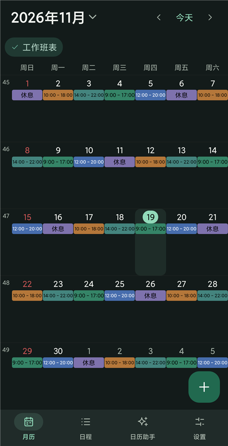
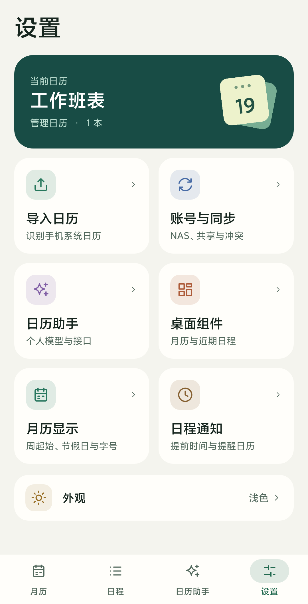
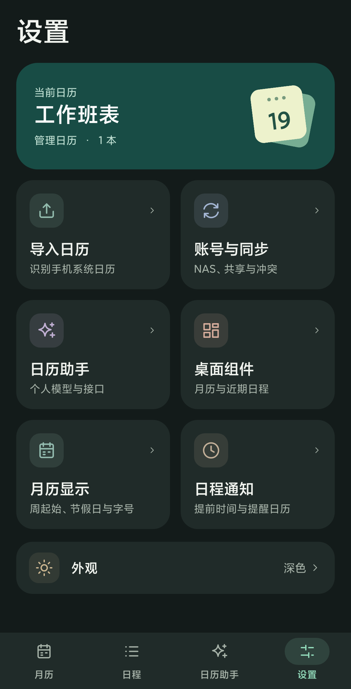
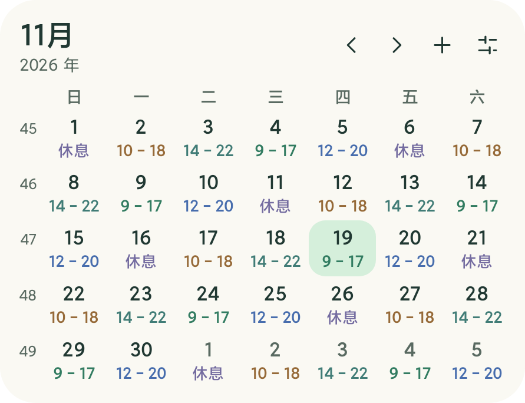

# TimePin 安卓版

0.15.3 可在「设置 → 账号与同步 → 待提交与冲突」找回本人留在这台手机上的离线输入。点一条草稿即可查看，点「保存草稿文件」可导出完整 JSON 命令。即使已失去原日历的访问权，登录同一实例的原账号仍可取回草稿。保存文件不会向原日历发送修改。「我的日历」继续只列可用日历。

0.15.1 修复小米 8（MIUI 12、Android 10）检查更新时误报安装包签名不符的问题。旧版遇到此提示时，使用原签名的 0.15.1 APK 覆盖安装一次，保留账号、日程和桌面绑定。之后在「设置 → 关于 → 检查更新」获取新版本。安装前会检查文件长度、SHA-256、包名、版本及完整签名集合。

0.14.2 修复退出账号后改用 HTTPS 登录，服务器有日程而手机显示 0 条的问题。覆盖升级后，打开 App 或点「立即同步」即可重新下载当前账号的日程。同一实例和成员通过校验后，手机沿用原日历编号及组件选择。如果升级前旧入口已经下线，手机也能建立独立副本；此时原组件若仍绑定旧副本，可在组件设置中选回新下载的日历。

0.14.1 支持在「设置 → 账号与同步 → 连接地址」填入同一服务器的 PassNAT 地址。首次切换时，原地址和新地址应同时可达。手机匿名比较两个入口对本次随机值的响应，确认同一实例后才在新入口使用原会话。原局域网地址始终可选回，本地日历编号、同步队列及桌面选择沿用。日历服务器可显式选择公网 HTTP，账号密码、会话和日程在公网上以明文传输。个人模型的公网接口仍要求 HTTPS。

Android 8.0（API 26）及以上可使用。首次打开便有一本「我的日历」。手机和两个桌面组件共用设备上的 Room 数据库。单机使用可直接在月历上点日期、点彩色班次或点右下角加号。顶部日历按钮控制叠加显示，左右滑动切换月份，点月份标题跳到指定日期。

点空白日期只会高亮选中，随后点加号即可在这一天新建日程。点有日程的日期会打开当天列表，点彩色班次可直接编辑。从桌面月历点空白日期也只会定位到当天。翻月、切换底部标签和进出设置分类时有短过渡，关闭系统动画后会直接切换。



## 安装与构建

从仓库根目录使用 JDK 17、Android SDK Platform 34 和 Build Tools 34。设好 `ANDROID_HOME` 或在未跟踪的 `android/local.properties` 中设置 `sdk.dir`。首次构建会下载 Gradle、Android 插件和 Room。

```sh
./android/gradlew -p android :app:assembleDebug
adb install -r android/app/build/outputs/apk/debug/app-debug.apk
```

开发版包名为 `org.timepin.app.dev`，真机仪器测试使用 `org.timepin.app.qa`。Gradle 首次构建测试包时会在用户主目录的 `.android/timepin-qa/signing.p12` 创建 QA 密钥，开发、预览、QA 及测试运行器共用这把密钥。如果手机留有 0.15.2 或更早的旧签名 QA 包，先导出需要的 QA 测试数据，再重装对应测试包。

日常版固定使用 `org.timepin.app`、release 构建和既有用户证书。正式证书 SHA-256 为 `0509439743daa2180ebeca26380374b42e07d7ca3d4b3b67b3a450f762c24bb5`。在此仓库的正式构建中，缺少密钥或证书指纹不同均会使构建失败。

Windows 发布机使用 `.\scripts\build_android_release.ps1`。它从当前 Windows 用户的 `%LOCALAPPDATA%\TimePin\signing` 读取专用 `release.p12` 和受 DPAPI 保护的口令 `release.dpapi`。跨机器恢复需要 PKCS12 私钥文件和独立保存的口令；DPAPI 文件限原 Windows 用户配置使用。迁移时从原发布密钥导入同一私钥和证书，正式别名为 `timepin-release`。CI 或其他系统从机密存储注入 `TIMEPIN_RELEASE_STORE`（仓库外路径）、`TIMEPIN_RELEASE_PASSWORD`，可选 `TIMEPIN_RELEASE_ALIAS` 与 `TIMEPIN_RELEASE_KEY_PASSWORD`，再执行 `./android/gradlew -p android :app:assembleRelease`。

用 SDK 的 `apksigner verify --print-certs` 分别核对原安装包、`android/app/build/outputs/apk/release/app-release.apk` 和 QA 包。正式证书应匹配原包，QA 与其运行器应匹配另一张证书。确认版本号递增和组件资源编号后，用 `adb install -r` 覆盖正式包，核对登录状态和两个组件原有的编号与日历选择。

### 自签名社区版

社区版使用包名 `org.timepin.app.community`。它与官方日常版可以并存，两者各有本地数据库和组件。要在社区版看到账号日历，登录同一服务器。仅保存在旧应用中的草稿需在原应用内取回。

首次构建时，在仓库外的私有目录生成并备份 PKCS12 私钥，保存密钥口令。以下为 Bash 示例，`keytool` 会交互式询问口令。后续版本沿用同一份密钥。

```sh
mkdir -p "$HOME/.timepin-signing"
export TIMEPIN_COMMUNITY_STORE="$HOME/.timepin-signing/community.p12"
keytool -genkeypair -storetype PKCS12 -keystore "$TIMEPIN_COMMUNITY_STORE" \
  -alias timepin-community -keyalg RSA -keysize 3072 -validity 10000
```

```sh
read -rsp 'Community keystore password: ' TIMEPIN_COMMUNITY_PASSWORD
echo
export TIMEPIN_COMMUNITY_PASSWORD
./android/gradlew -p android :app:assembleCommunity
unset TIMEPIN_COMMUNITY_PASSWORD
```

Windows PowerShell 可在私有目录使用同一条 `keytool` 命令。将仓库外的完整路径放入 `$env:TIMEPIN_COMMUNITY_STORE`，然后运行以下命令。自定义别名使用 `TIMEPIN_COMMUNITY_ALIAS`，独立密钥口令使用 `TIMEPIN_COMMUNITY_KEY_PASSWORD`。

```powershell
$secret = Read-Host 'Community keystore password' -AsSecureString
try {
    $env:TIMEPIN_COMMUNITY_PASSWORD = [Net.NetworkCredential]::new('', $secret).Password
    .\android\gradlew.bat -p android :app:assembleCommunity
} finally {
    Remove-Item Env:TIMEPIN_COMMUNITY_PASSWORD -ErrorAction SilentlyContinue
}
```

产物在 `android/app/build/outputs/apk/community/app-community.apk`。用 SDK 的 `apksigner verify --verbose --print-certs <APK>` 核验签名，首次安装可用 `adb install <APK>`。分发给用户时，同时提供 SHA-256 和社区证书指纹。在实例中保持一个社区签名身份，来自其他维护者的同包名社区版需要其原签名才能覆盖现有安装。

### 通过服务器更新

1. 部署支持相应包名的服务器。管理员在「版本管理」上传已签名的 APK 并填写更新说明。自部署者也可直接上传未改动的官方包。
2. 成员从个人 Web「设置 → 关于 TimePin」下载自己需要的版本并首次安装。已安装用户在手机「设置 → 关于 → 检查更新」获取自己包名对应的更新。
3. 发下一个版本时，提高 `contract/v1/release.json` 中的 `versionCode`，更新 `versionName`，用同一密钥重新构建并上传。服务器按包名保存版本，手机核对大小、SHA-256、包名、递增版本和签名后交给系统安装器确认。覆盖升级保留应用数据和组件绑定。[Android 应用签名说明](https://developer.android.com/studio/publish/app-signing)

## 设置

点设置首页顶部的日历卡管理或新建日历。「外观」集中管理应用主题、月历显示与每个桌面组件的背景。导入日历、账号与同步、日历助手、添加桌面组件和日程通知有各自的入口。

| 浅色 | 深色 |
|---|---|
|  |  |

## 导入系统日历

从 0.10.2 起，打开 App 并授予读取日历权限后，TimePin 会自动识别可读的系统日历并添加到本机，包括空日历。在前台新增或修改系统日程后会合并导入；离开期间的变化在下次打开 App 时补入。可在「设置 → 导入日历」关闭自动导入，已导入内容会保留。拒绝授权后，可从同一页再次授权。

自动导入先写入手机。登录后，同一来源后续新增和修改的日程进入这本日历的同步队列。旧版带「（本机）」后缀的日历继续使用原编号及组件绑定。TimePin 和 Web 之间双向同步。安卓系统日历提供程序使用只读权限。在 TimePin 主动删除自动导入的本机日历后，后续自动扫描会跳过它。需要按来源或年份手工导入时，进入「设置 → 导入日历 → 识别手机系统日历」，勾选来源并选择起止年份。每个来源对应一本本机日历，默认范围含去年、今年和明年。重复日程按所选范围导入为独立的各次安排。再次导入可新增或修订同一来源的记录，手机日历中的删除不会删除已复制的日程。本机另行编辑过的条目会列作冲突。日常使用版只申请读取权限。

## 日程通知

在「设置 → 日程通知」开启通知，在「选择提醒日历」勾选来源。提醒开关与月历是否显示该日历分别保存。提前时间可设为 0 至 10080 分钟，默认 15 分钟。定时日程以开始时刻为准，全天日程以设备时区当天 09:00 为准。系统限制精确闹钟时，提醒使用系统允许的投递时机。

## 月历显示与桌面组件

「设置 → 外观 → 日期与字号」可选周日或周一起始、显示周数、显示中国农历和四档字号。桌面月历沿用手机设置。节假日默认跟随系统地区，也可手动选择国家或地区或关闭。国家级公共假日随应用离线提供，数据范围为 2020–2035 年，未来年度的临时安排需随数据更新。中国内地 2026、2027 年含官方公布的放假和调休上班日期。节假日和农历只作为日期标注。

新安装默认使用「雾光 · 毛玻璃」和冰蓝纯色（#DCE7F4）。已有的主题与背景选择优先。进入「外观 → 雾光主题背景」可选择渐变、设备图片或纯色。纯色支持六种预设、拖动红绿蓝滑块和输入六位颜色值。保存后应用，返回会放弃草稿。每个桌面组件都能独立选择背景，也可跟随应用背景。点组件右上角的设置按钮也能打开对应背景。组件柔化自己的底图，桌面宿主负责合成。图片在设备上处理，更新日程时复用背景纹理。应用内列表弹窗、表单、日期和时间选择器及底部操作卡采用当前主题，系统选图与权限窗口由 Android 绘制。

从系统桌面的小工具选择器添加「TimePin 月历」或「TimePin 近七天」，也可以在「设置 → 桌面组件」里点添加。MIUI 的应用内添加入口受「权限管理 → 其他权限 → 桌面快捷方式」控制。每个组件右上角的调节图标 可以单独勾选日历。月历可翻月、点日期、添加事件，窄格按宽度缩短时间。近期日程按设备时区列出近七天，可点班次进入详情。组件高度决定可见行数。

**拖动调整大小。** 在小米 8 的 MIUI 12 桌面，长按组件内的空白处，轻轻拖动一点，再在原位置附近松手。蓝色边框出现后，拖左右菱形手柄调宽度，拖上下手柄调高度，最后点桌面空白处。组件按桌面网格占位，向外扩展的一侧需要有空格。

全天班次标题会保留原来的起止时间。比如 `12:00-21:00` 在宽月历格中显示为一行，窄而高的格子会在连字符处换行。月历压到只能放日期时，底部用一行显示本月最近的有日程日期和标题。近期日程组件的紧凑布局优先把宽度留给班次标题。缩放只改变桌面显示，组件的日历选择和事件的全天属性照常保留。

0.11.1 在小米 8 的 MIUI 桌面验证了近期日程从三列拖到四列、月历从三行拖到两行，随后都恢复原尺寸和位置。独立 QA 包导入全天班次后，通过系统尺寸回调检查月历从 128×104 到 520×300 dp 的多种布局，以及近期日程的 110×68 和 340×220 dp 布局。检查包含屏幕文字的省略、行宽和底部裁切。

冰蓝主题版在 Android 14 标准模拟器上通过全部 10 项 `AppearanceTest`，包括实际尺寸回调、全天班次末位显示、三个主题的返回控件、拖动取色、取消与保存。在 MuMu Android 15 上通过 9 项。MuMu 的尺寸回调用例在 520×300 dp 超时，独立用例 `testReconcileResizeAndAllDayShiftTitle` 验证了重新进入应用时的组件重排和标题完整性。覆盖安装 MuMu 雾光版前后核对了已保存的组件日历选择和背景。

| 桌面月历 | 近期日程 |
|---|---|
|  |  |

## NAS 同步与模型

1. 在「设置 → 账号与同步 → 登录自部署实例」输入手机可达的实例地址与账号。公网使用 HTTPS，局域网可填私网 IP 和端口。尚无账号时先在实例 Web 注册，或打开成员邀请。
2. 登录后自动下载账号可访问的日历。后来新建、获邀加入或经团组授权的日历也会出现。手机自动上传所有未连接的本机日历，包括系统导入日历；未登录仍可离线使用。日历、事件和组件保留原编号。
3. 手机和 Web 对同一本日历的新增、编辑、删除会双向同步。前台在联网、登录和本机编辑时检查变化，持续打开时每 30 秒自动检查。NAS 暂不可达时，手机保存编辑并登记联网重试。离开 App 后由 Android 调度，另有每小时的周期任务，具体执行时间受系统省电策略影响。「立即同步」仍可主动检查。
4. 两人改同一条班次时，在「设置 → 账号与同步 → 待提交与冲突」查看本机草稿与服务器版本。只有一条改班冲突时，可以在核对后采用自己的改班。采用远端版本会明确提示放弃该日历的全部待处理草稿后重建副本。撤权会清除对应副本，保留本人的未提交输入。
5. 「设置 → 日历助手 → 配置个人模型」可更换兼容 Chat Completions 的地址、模型名称和 API Key，默认地址为 DeepSeek。在「日历助手」选择日历和「个人模型」，写入前可查看具体提案。「实例共用模型」使用服务器为成员分配的权限和凭据，单次编辑直接采用对应的实例回执，批量改动另行确认。个人密钥和登录会话由 Android Keystore 加密保护。[实例模型授权](./automation.md#配置-deepseek-或兼容服务)

自动同步验收使用开放注册的独立测试实例和 QA 安装包。下例的实例监听电脑回环端口 19681。代理仅中断测试实例的连接；测试会让系统执行已登记的重试任务。测试结束后关闭代理并移除两个 ADB 端口映射。

```sh
python scripts/android_sync_fixture.py --server-port 19681
# 在另一个终端执行
adb reverse tcp:19682 tcp:19682
adb reverse tcp:19683 tcp:19683
adb shell am instrument -w -e serverUrl http://127.0.0.1:19682 -e gateUrl http://127.0.0.1:19683 -e class 'org.timepin.app.DeviceTest#testConnectedAutoSync' org.timepin.app.qa.test/android.test.InstrumentationTestRunner
```

0.11.0 在 USB 接电的小米 8 上通过上述用例。账号内容未变化且日历在 Web 可见时，一次检查的摘要正文为 80 字节，未请求事件页。模拟 NAS 返回 503 后，手机保留待提交事件；恢复测试端点并触发系统已登记的重试任务，事件成功上传。另在日常版与飞牛 NAS 之间验证，保持手机月历打开后，服务器新建的日历及首条事件在两次验收中分别约 21 秒、31 秒后出现，手机改名后服务器事件版本从 1 更新为 2。

## 设备 JSON 接口

已授权的 ADB 连接可查询 `content://org.timepin.app.device` 提供的命令。执行 `adb shell content call --uri content://org.timepin.app.device --method tools` 读取参数定义。用 `--method display.detail` 读取当前设置，写入使用 `display.update` 加一个 JSON 对象作为 `--arg`。支持 `reminders.detail/update` 和 `system.list/import`。系统读取与通知权限由手机用户授权。自配模型使用同一组设备命令，写入前在手机上确认。[设备契约](../contract/v1/device.json)

## 真机复测

使用专用测试实例、临时账号及 QA 包。先按 [工程规约](../AGENTS.md) 构建三个 APK，安装两个测试 APK。测试包 id 与用户版分开。以下 shell 片段从仓库根目录执行，`ANDROID_SERIAL` 可指定设备。设置测试实例的模型授权前先为手机测试账号授予共用模型权限。

```sh
runner=org.timepin.app.qa.test/android.test.InstrumentationTestRunner
testclass=org.timepin.app.DeviceTest
adb shell appwidget grantbind --package org.timepin.app.qa --user 0
adb shell am instrument -w -e class "$testclass#testPortableContract" "$runner"
```

1. 从空的 QA 包数据开始，记录原飞行模式与 Wi-Fi 状态。在真机开启飞行模式运行 `testFlightAndWidgets`。该用例准备离线事件、绑定两个组件、在各自配置页保存选择并检查实际 RemoteViews。结束后恢复原网络状态。
2. 在专用实例环境运行 `python3 scripts/android_model_fixture.py` 启动回环测试模型。将实例的 `TIMEPIN_AI_BASE_URL` 指向该端点，给手机提供可达的相同端点。USB 联测可用 `adb reverse` 转发到电脑的测试服务。模型请求都在受控环境内完成。
3. 执行下面的发布和对话测试。变量填专用测试身份，测试命令的参数可在设备调试记录中出现。用第二个账号在 Web 把发布日历中的「模型调整后的晚班」改名为「家人改班」、改为 15:00–23:00。运行 `testFetchRemote` 并用 CLI 的 `event.get` 比对。
4. 运行 `testRetryAndConflict` 验证服务端已提交而手机丢失回执的重试，以及远端和手机同时改同一条事件。运行 `testMonthAndRefresh` 导入一月样例并检查刷新范围。可分别以 `-e widget month` 和 `-e widget agenda` 运行 `testRequestLauncherWidget`，在系统桌面核对实际组件。
5. 结束时清理本次测试的 NAS 实例、模型、账号和临时转发，撤销测试包的组件绑定授权并卸载两个 QA 包。保留日常使用版。ADB 的仪器运行器需要输出 `OK (1 test)` 才算通过。

```sh
adb shell am instrument -w -e class "$testclass#testPublishAndModel" \
  -e url "$TEST_NAS" -e name "$TEST_USER" -e password "$TEST_PASSWORD" \
  -e modelUrl "$TEST_MODEL" "$runner"
adb shell am instrument -w -e class "$testclass#testFetchRemote" "$runner"
adb shell am instrument -w -e class "$testclass#testRetryAndConflict" "$runner"
```

0.7.0 的「发现局域网服务器」只在用户查找时发送探测，点选结果进入正常登录。手输地址和离线模式均保留。在「日历助手 → 配置个人模型」下拉选择已有配置、预设服务或「＋ 自定义兼容接口」，保存后在对话页选择个人或实例共用模型。已有个人模型配置可继续使用。

### 助手的日历范围

事件编辑器提供常用色、跟随日历和自定义六位颜色值，定时事件可从时区列表选择，全天事件以日期保存。

助手顶部默认勾选当前来源可访问的全部日历。用横向复选项选择几本，点「全部日历」可全选或清空。个人模型可使用本机日历和本机已有的共享副本；实例模型可使用该账号在服务器上获准访问的日历，包括尚未同步到手机的日历。仅在助手中选中日历不会创建离线副本。服务器不会因一次对话而发布本机日历。回复按片段显示，可停止接收。多本日历中修改班次会显示目标和确认操作。发送按钮旁可选择回车换行或发送。日历设置可确认删除当前本机日历；删除已连接日历需要联网，由服务器核验所有者或团组管理员权限。

0.10.1 在小米 8 的独立 QA 包验证了个人模型和实例模型的流式回复、两本日历合并查询、确认改班及排除第三本日历。实例模型也查询了手机尚未订阅的日历。两条链路使用临时兼容模型。另测了日历复选、空日期、返回导航、时区与自定义颜色保存、跨端样例和两种小组件。

0.10.2 在小米 8（Android 10）用系统日历提供程序验证自动导入。独立 QA 包覆盖首次授权、前台新增来源和事件、修改、关闭与恢复、删除本地副本、旧库迁移及共享编号隔离。固定的 30 个单日班次、单日历和一年窗口中，首次扫描耗时 360 ms，第二次耗时 48 ms，跳过 30 条，新增批次为 0。修订一个班次耗时 52 ms，更新 1 条，跳过 29 条。时间为一次真机运行的经过时间。
### 安卓助手操作验收

使用已绑定权限的 QA 包和空的回环测试实例；实例开放注册、后台账号为 `tester`，测试密码为 `qa-stream-only-credentials`，实例模型指向 `scripts/android_model_fixture.py`。将实例和模型监听端口分别通过 ADB reverse 映射给手机。执行以下命令，把两个示例端口替换为本次回环端口。

```sh
adb shell am instrument -w -e class 'org.timepin.app.DeviceTest#testAccountAndDeviceActions' -e serverUrl http://127.0.0.1:28471 -e modelUrl http://127.0.0.1:28472 org.timepin.app.qa.test/android.test.InstrumentationTestRunner
```

用例创建测试账号，绑定专用月历和近期日程组件，经对话分别配置，自动同步本机日历，再制造两次版本冲突。分别核对采用本机和采用远端、过期确认、重试、模型撤权和账号邀请。

### 小米桌面在覆盖升级后提示「载入窗口小部件时出现问题」

旧版 MIUI 桌面可能缓存组件资源。遇到载入错误，重新启动桌面进程或正常重启手机可以让桌面重新读取布局。新版构建保留原组件资源编号。

### 桌面组件圆角与启动图标

0.13.2 让纯色背景直接绘制圆角，并在毛玻璃与自选图片的背景纹理中保留透明四角。两种组件与紧凑布局都沿用 22 dp 的圆角。启动图标采用绿色底层和白色日历前景，桌面可按系统图标形状裁切。

### 连接服务器与账号登录

0.14.0 的「设置 → 账号与同步」支持匿名连接服务器。手填地址或选择局域网发现结果后，手机校验 TimePin 标识并记住地址。点「登录 TimePin」进入独立页面，也可选择「注册新账号」并填写邀请码。连接本身不启动账号同步。退出后可继续离线使用，或在原服务器登录其他账号；密码重设后可在原账号卡片点「重新登录」保留本机副本。设备命令 `server.detail` 与 `server.connect` 只返回所选地址和登录状态。

## 日历分享和团组

在「设置」点当前日历卡片，选择要分享的日历，再打开「分享与成员权限」。日历管理者可以把权限授予指定账号或已加入的团组，也可以按角色创建一次性邀请。邀请在 7 天内有效，使用一次即失效。亲友只需要查看日程时，可以开启免登录只读链接。点「分享…」选择接收应用，或点「复制链接」。更换或关闭只读链接会让原链接立即失效。

在「设置 → 我的团组」创建团组，或用邀请加入日历、团组。组管理员可以添加成员、调整角色、移除成员、撤销待接受的邀请、移交管理权，以及创建归团组所有的日历。普通成员可以查看自己的团组和团组日历。加入共享的日历会随账号同步到手机。

这些操作需要登录服务器并联网。分享链接使用手机当前的连接地址。要发给局域网外的人，请使用接收方也能访问的服务器地址。
